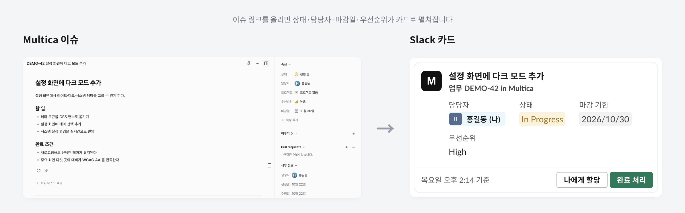
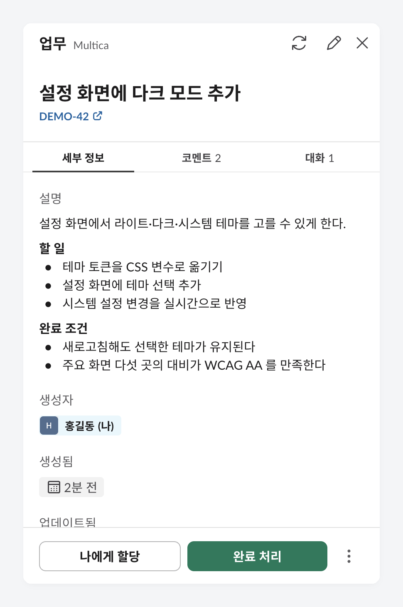
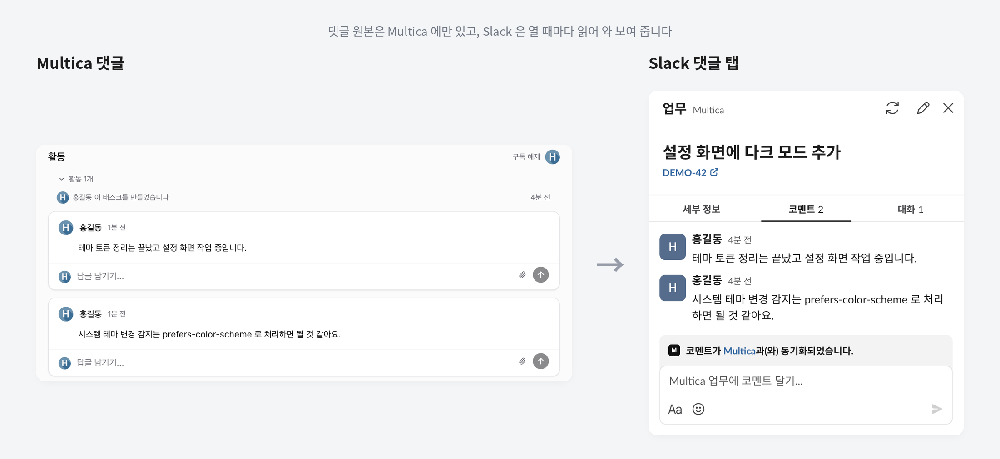

# multica-slack

[Multica](https://github.com/multica-ai/multica) 를 Slack 안에서 다루는 기능 모음. Slack 앱 하나에 Socket Mode 로 붙는 Bolt 프로세스에 기능을 하나씩 얹는다.



카드를 누르면 오른쪽 패널에 설명과 작성자가 나오고, 버튼으로 바로 할당하거나 완료 처리할 수 있다. 연필 아이콘으로 상태, 우선순위, 마감일을 고친다.

<p align="center"></p>

댓글 탭은 Multica 댓글을 그대로 읽어 와 보여 준다. Slack 쪽에 사본을 따로 두지 않는다.



## 기능

| 기능 | 하는 일 | 문서 |
|---|---|---|
| `unfurl` | Multica 이슈 링크를 Slack Work Object 카드로 펼치고, 버튼, 패널 편집, 댓글 탭을 붙인다 | [docs/unfurl.md](docs/unfurl.md) |
| `chat` | 봇 DM 과 채널 멘션을 Multica 에이전트 채팅으로 잇고, `/issue`, `/new`, `/clear` 를 처리한다. Multica 서버 내장 Slack 연동을 대신한다 | [docs/chat.md](docs/chat.md) |

## 구조

```
src/
  index.js              Bolt 앱 생성, 기능 등록
  lib/
    multica.js          Multica REST 클라이언트(조회와 쓰기, 멤버와 에이전트 캐시)
    slack-users.js      Slack 유저 ↔ 이메일 조회 캐시
  features/
    unfurl/             기능 하나 = 폴더 하나. index.js 가 register(app, ctx) 를 내보낸다
    chat/               DM·멘션 ↔ Multica 채팅, /issue /new /clear
scripts/
  unfurl/               기능별 점검 스크립트
docs/
  unfurl.md             기능 설명, 필요한 Slack 앱 설정
  unfurl.manifest-patch.json
```

새 기능을 붙일 때는 `src/features/<이름>/index.js` 에서 `name` 과 `register(app, ctx)` 를 내보내고 `src/index.js` 의 `FEATURES` 에 넣는다. Multica 호출은 `src/lib/multica.js` 에 모은다. 기능이 요구하는 Slack 앱 설정(이벤트, 스코프)은 `docs/<이름>.md` 에 적는다.

## 실행

```bash
npm install
cp .env.example .env        # Slack 봇 토큰, app-level 토큰, Multica 접속 정보 채우기
npm run dev                 # 로컬 개발(파일 저장 시 자동 재시작)
npm start                   # 운영
```

## Docker

```bash
docker build -t multica-slack .
docker run -d --name multica-slack --restart unless-stopped --env-file .env multica-slack
docker logs -f multica-slack          # feature registered / started 가 찍히면 정상
docker stop multica-slack             # SIGTERM 을 받아 소켓을 닫고 종료(exit 0)
```

- 이미지는 `node:22-alpine` 2단계 빌드, 운영 의존성만 넣고 `node` 유저로 돈다.
- 컨테이너에는 multica CLI 설정 파일이 없으므로 `MULTICA_SERVER_URL`, `MULTICA_WORKSPACE_ID`, `MULTICA_TOKEN` 을 환경변수로 넘긴다. 필수 값이 비어 있으면 시작하자마자 오류로 멈춘다.
- 점검 스크립트도 들어 있다: `docker run --rm --env-file .env multica-slack node scripts/unfurl/dry-run.js <이슈 URL>`

## 환경변수

| 이름 | 값 |
|---|---|
| `SLACK_BOT_TOKEN` | Slack 앱 봇 토큰(`xoxb-`) |
| `SLACK_APP_TOKEN` | Slack 앱 app-level 토큰(`xapp-`, `connections:write`). 있으면 Socket Mode |
| `SLACK_SIGNING_SECRET` | app-level 토큰 대신 HTTP 모드로 돌릴 때 (`POST /slack/events`) |
| `MULTICA_SERVER_URL` | Multica 서버 주소 |
| `MULTICA_APP_URL` | Multica 웹 주소(이슈 링크의 호스트). 비우면 `MULTICA_SERVER_URL` |
| `MULTICA_WORKSPACE_ID` | Multica 워크스페이스 ID |
| `MULTICA_TOKEN` | Multica 개인 액세스 토큰(`mul_`) |
| `RESOLVE_SLACK_USERS` | `false` 면 이메일 기준 Slack 프로필 매칭을 끈다 |
| `LOG_LEVEL` | `debug` 면 Slack 요청을 전부 로그로 남긴다 |

`MULTICA_*` 값이 비어 있으면 multica CLI 설정 파일(`~/.multica/config.json`)의 `server_url`, `app_url`, `workspace_id`, `token` 을 쓴다. CLI 로 로그인해 둔 개발 머신에서는 Slack 토큰만 채우면 된다. 기능별 변수는 각 기능 문서에 있다.

## 주의

Slack 앱 하나에 소켓을 여는 프로세스는 이것 하나만 둔다. 로컬 개발 서버, 배포본, 다른 자동화 도구의 Socket Mode 트리거가 같은 앱에 동시에 붙으면 Slack 이 이벤트를 연결들에 나눠 보내 일부가 빠진다. 배포본을 띄울 때는 로컬 개발 서버를 끈다.

Multica 서버의 Slack 연동(채널 기능)도 같은 이유로 이 프로세스와 같은 앱을 쓰면 안 된다. `chat` 기능이 그 연동을 대신하므로, 이 프로세스를 붙이기 전에 Multica 에서 그 앱의 Slack 설치를 끊는다. 순서는 [docs/chat.md](docs/chat.md) 의 "옮겨 올 때" 에 있다.

## 라이선스

MIT. [LICENSE](LICENSE) 참고.
